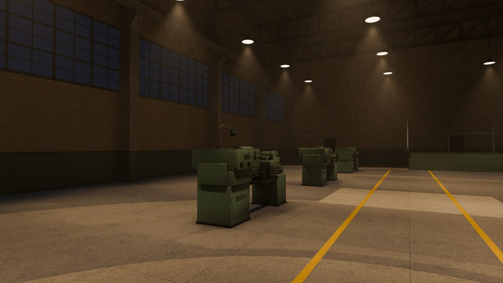
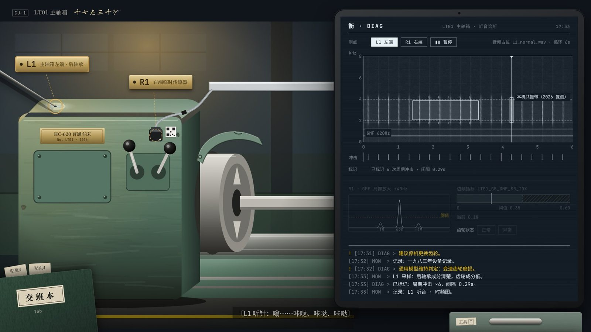
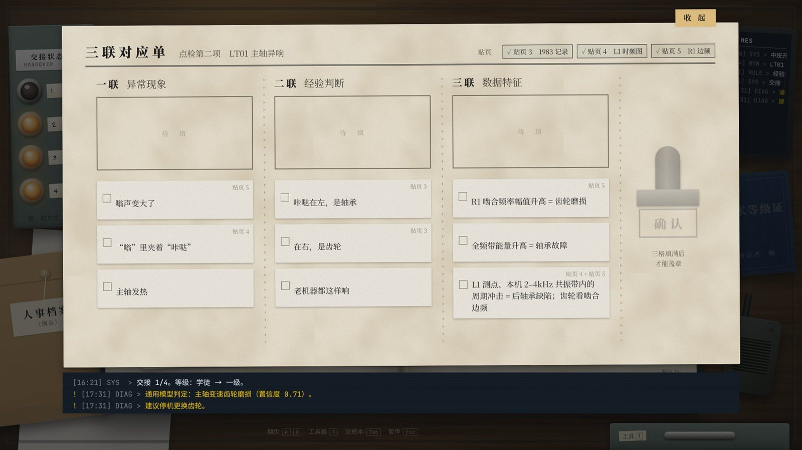
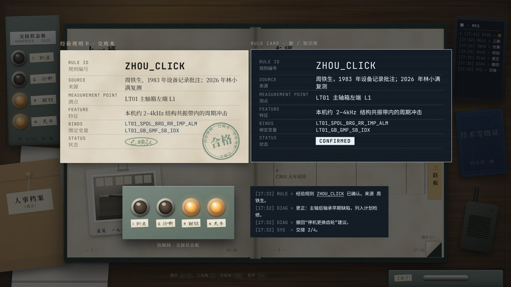

# 最后一次交班 · The Final Handover

> 机器会停，手艺不停。
> *Machines stop. Craft carries on.*

  



**《最后一次交班》** 是一款第一人称、节点式固定机位的 3D 叙事诊断解谜游戏。

2026 年 10 月，一座老机械厂的三号车间迎来最后一个人工中班。明天起，新的智能制造系统“衡”接管车间。你是调试员林小满，接过老班长的最后一卷交班本。你要用听针、手电和时频图取证，把三代工人“说不清”的经验翻译成衡能执行的规则。

每条规则都以老师傅的名字命名，比如 `ZHOU_CLICK`、`JIANGUO_GUARD`、`SUN_HALFBEAT`。每确认一条，旧控制柜上就熄灭一盏交接灯。

这不是一个“回看过去”的怀旧游戏，而是一个**翻译游戏**：把老师傅的耳朵，翻译成机器的参数。

---

## 为什么值得关注

| | |
|---|---|
| **把默会知识做成可玩的机制** | 波兰尼说“我们知道的多于我们能说出的”。本作把这句话做成核心循环：异常现象 → 经验判断 → 数据特征的**三联对应**。玩家亲手把一句“咔哒在左，是轴承”变成一条可验证的诊断规则。 |
| **声音就是线索** | 听针贴上主轴箱，在实时时频图上框出轴承冲击的竖条纹，从而纠正 AI 的误报。所有声音信息都同步可视化，听障玩家也能通关。 |
| **错误也会被认真对待** | 选错不扣分。衡会按你写的错误规则去**仿真**，让你自己听出“不对”：换过齿轮，咔哒还在；把规则写成固定秒数，绳长一变就失效。 |
| **工程上站得住** | 四个谜题分别对应振动测点选择、包络 / 共振带诊断、安全联锁和 ZV 输入整形，并配有年代与工程考据表。懂行的人不出戏，不懂的人学到的是对的。 |
| **完全数据驱动、可测试** | 玩法逻辑是一个不引用 UnityEngine 的纯 C# 程序集，可以脱离引擎编译和测试。62 项自动化测试覆盖数据完整性、主流程、四个谜题、提示、存档和文本预算。 |

<table>
<tr>
<td></td>
<td></td>
<td></td>
</tr>
<tr>
<td align="center">听：在时频图上框出“咔哒”</td>
<td align="center">写：三联对应</td>
<td align="center">交：以人名命名的规则</td>
</tr>
</table>

---

## 仓库内容

```
unity/            Unity 2022.3 LTS + URP 14 工程（Demo α：第 1 章逻辑层完成并通过 62 项测试；表现层代码待在 Unity 中验证）
  UnityProject/
    Assets/LSB/            核心代码、测试、UI Toolkit 样式、开源字体子集
    Assets/LSB_Stage3/     Stage 3 美术接入：Hero 资产、灯光、关键机位
    Assets/LSB_Art/        FBX 模型与贴图
  tools/                   脱离 Unity 的 dotnet 编译与测试工程
web-prototype/    高保真可点击 UI 原型（纯 HTML/CSS/JS，零依赖，双击即开）
blender/          程序化建模与渲染脚本（车床、天车、继电器柜、道具、厂房）
vfx/              三个关键特效的 Look-dev（记忆显影、规则 ID 重组、交接灯熄灭）
docs/
  design/                  谜题事实链、车间白盒规格、听音诊断原型、年代与工程考据表
  verification/            测试与编译检查记录
  images/                  关键画面
```

### 架构

```
┌───────────────────────── LSB.Core（纯 C#，noEngineReferences）──────────────────────────┐
│  Data/ContentDB      节点 · 特写 · 26 件交互物 · 证据 · 交班本跨页 · 三联 · 规则卡 · 提示 · 台词 │
│  Systems/            Flow · Navigation · Interaction · Evidence · Ledger · Triad ·          │
│                      KnowledgeRule · Hint · Dialogue · Save                                 │
│  Sim/                SpectroModel（时频图 / 边频）· CraneZvModel（单摆 + 两段整形）·           │
│                      GuardTwinModel（护罩启动许可的数字孪生）                                 │
└───────────────────────────────────────────▲─────────────────────────────────────────────┘
                                            │ 只读数据 + 事件
┌──────────────── LSB.Runtime（Unity）──────┴───────────────┐   ┌── LSB.Editor ──┐
│ GameBootstrap · 灰盒 / 场景生成 · 节点机位 · 交互拾取 ·     │   │ 一键生成场景   │
│ UI Toolkit 面板 · 占位音频 · 存档                           │   │ 节点截图 · 自检 │
└────────────────────────────────────────────────────────────┘   └────────────────┘
```

- 系统代码里不写死任何文案，全部内容都在 `ContentDB` 中。新增一章主要是新增数据，而不是新增系统。
- 测试源文件只有一份，Unity Test Runner 和 `dotnet test` 共用。

---

## 快速开始

**网页原型（最快）**：双击 `web-prototype/index.html`，或打开单文件版 `web-prototype/dist/最后一次交班_UI原型.html`。原型覆盖谜题二“咔哒在左”的完整流程，详见 [web-prototype/README.md](web-prototype/README.md)。

**Unity 工程**：

1. 用 Unity Hub 打开 `unity/UnityProject`（Unity 2022.3 LTS）。
2. 菜单 **LSB → 1 一键生成 Demo 场景**，然后按 Play。

完整说明、操作方式和系统表见 [unity/README.md](unity/README.md)。

**只跑逻辑层测试（无需 Unity）**：

```bash
cd unity/tools/CoreTests
dotnet test
```

---

## 路线图

| 阶段 | 内容 |
|---|---|
| ✅ Demo α（逻辑） | 第 1 章《三号车间》4 个谜题、结局、存档、提示系统的逻辑层，62 项测试全过，可无头通关；网页原型覆盖谜题二完整流程 |
| ⏳ Demo α（引擎） | Unity 表现层代码已写并对照参考库编译通过，尚未在 Unity 编辑器中运行验证 |
| ✅ Stage 3 | Hero 资产（LT01 车床、CR01 天车、继电器柜）、灯光、关键特效 Look-dev |
| ⏳ 可用性测试 | 两轮 5 人测试（方案已就绪，见设计文档） |
| 🔜 全版 | 6 章、6 个车间与工种：车床、天车、冲床、热处理炉、配电室、名册 |
| 🔜 延伸 | 触屏平板版；工业博物馆互动展项；职业教育点检实训模块 |

---

## 致谢与声明

- 人物、厂名、城市与设备型号均为虚构。
- 字体均为 SIL Open Font License 授权，许可证随字体文件附带（见 `unity/UnityProject/Assets/LSB/Fonts/licenses`）。
- 部分程序原型、程序化模型与贴图借助 AI 辅助工具以脚本方式生成，并经团队审核修改。网页原型中的占位视觉仅用于交互说明。

## 许可

- 代码（`*.cs`、`*.py`、`*.js`、`*.html`、`*.css` 及构建脚本）：[MIT](LICENSE)
- 美术资产、设计文档与图片：[CC BY-NC 4.0](https://creativecommons.org/licenses/by-nc/4.0/)，详见 [LICENSE-ASSETS.md](LICENSE-ASSETS.md)
- 字体：各自的 SIL OFL 1.1 许可证
