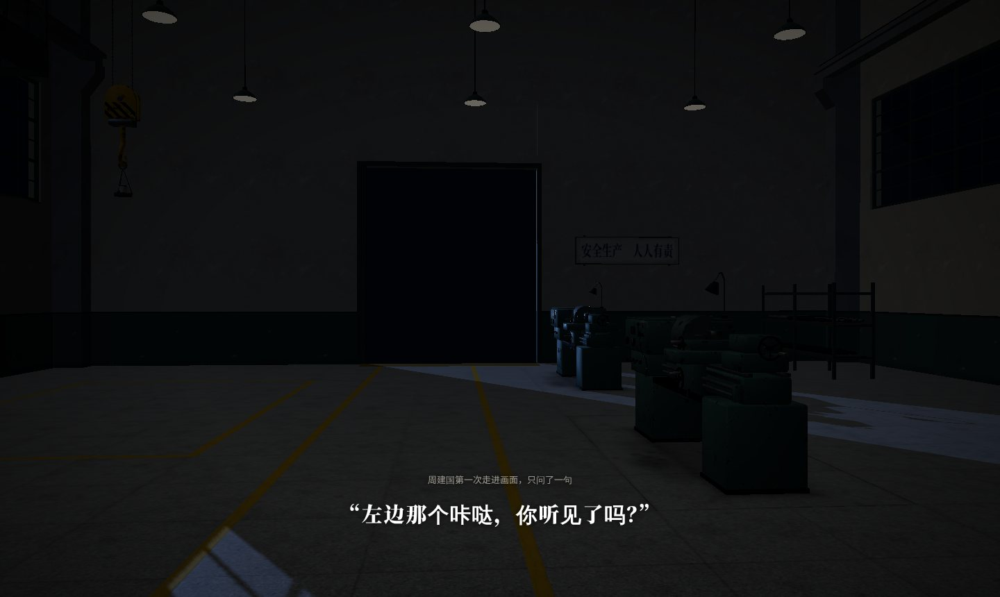

# showroom · 在线演示

浏览器里直接看的三号车间和模型展厅。仓库根目录的 `index.html` 是入口。

| 页面 | 内容 |
|---|---|
| `scene.html` 三号车间 · 拉闸之后 | 整座车间（厂房壳体、四台车床、天车、继电器柜、交班桌、更衣柜、18 盏吊灯和杂项道具）。夜班 / 白天两套光，六个机位；右下角拉下总闸，六排钨丝灯由近及远熄灭，交班桌台灯留着。 |
| `index.html` 模型展厅 | 11 件模型逐件看：钨丝灯 / 白天光、线框、自动旋转；每件附故事、三角面数、尺寸和贴图规格。地址后加 `#lt01`、`#cabinet` 这样的锚点可以直接打开某一件。 |



## 怎么打开

- **在线**：仓库开了网页模式，打开根目录 `index.html`。
- **本地**：双击根目录 `index.html`，不需要起服务器。
- 建议用电脑上的 Chrome 或 Edge。3D 页面第一次载入约 8 MB；如果帧率低，场景页会自动关掉吊灯阴影、降低分辨率。

## 为什么是这种写法

匿名仓库的网页模式给每个页面加了沙箱（没有同源权限，也不发跨域头），`fetch`、ES 模块和外部字体文件都会被拦下。所以：

- three.js r170 打成一个普通 `<script>`（`lib/three-bundle.js`，入口 `tools/three-entry.js`，esbuild 打包）。
- 模型是 GLB 切成约 0.9 MB 的 base64 片段，放在 `models/*.js` 里，用普通 `<script>` 逐片载入，再交给 GLTFLoader 解析。
- 字体按页面实际用到的字做子集，以 data: URL 写进 `fonts.css`（思源宋体、思源黑体、JetBrains Mono，均为 SIL OFL 1.1）。
- `localStorage` 全部包在 try/catch 里。

同样的原因，双击本地打开（`file://`）也能正常看。

## 怎么重新生成

```
# 1. 贴图缩小，Unity 的 MS 图（R 金属度 / A 光滑度）转 glTF 的 ORM
LSB_STAGE3=<Stage 3 美术源目录> python3 tools/prep_tex.py tools/tex
# 2. Blender 导出 GLB（bpy 5.x）：11 件单品 + 整座车间
LSB_STAGE3=<…> python3 tools/export_web.py asset lt01 <glb 目录>     # 其余 key 见脚本里的 ASSETS
LSB_STAGE3=<…> python3 tools/export_web.py scene <glb 目录>
# 3. 压缩：meshopt 几何 + WebP 贴图（场景保留节点结构，吊灯要逐排控制）
npx @gltf-transform/cli optimize in.glb out.glb --compress meshopt --texture-compress webp
npx @gltf-transform/cli optimize scene.glb scene_opt.glb --compress meshopt --texture-compress webp --join false --instance false --palette false --flatten false
# 4. 切片写进 models/，再生成字体子集和首页
python3 tools/pack_models.py <优化后的 glb 目录>
python3 tools/subset_fonts.py <字体目录>
python3 tools/build_landing.py
```

Stage 3 美术源目录指各资产的 FBX、贴图集和厂房 `.blend`；FBX 和贴图也在 `unity/UnityProject/Assets/LSB_Art/` 里，建模脚本在 `blender/`。

## 许可

模型、贴图和截图按 CC BY-NC 4.0（见根目录 `LICENSE-ASSETS.md`），页面代码按 MIT。`lib/three-bundle.js` 来自 three.js（MIT，见 `lib/three-LICENSE.txt`）。
